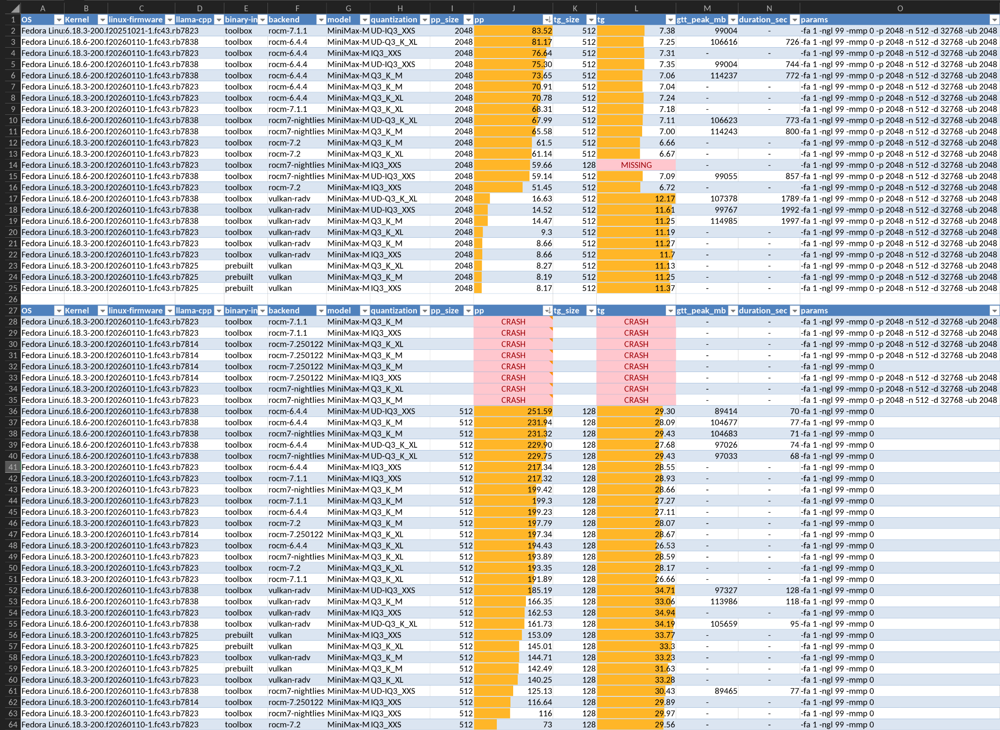
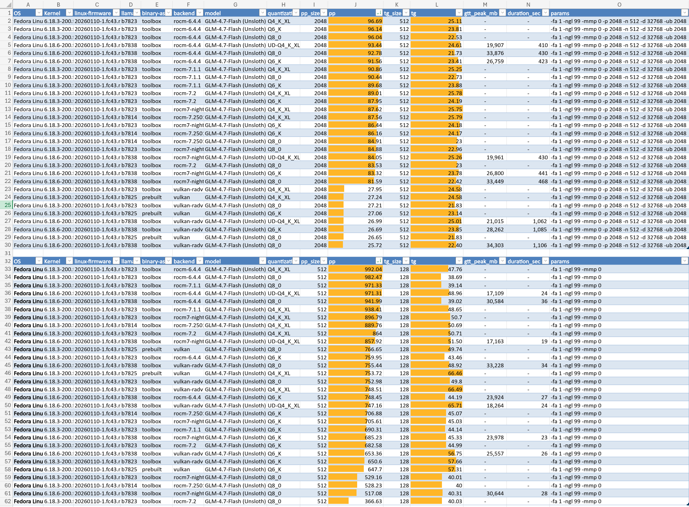
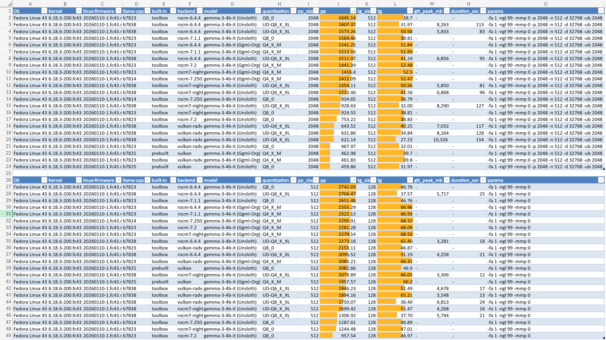

# What is llamathon ?

Measures how fast llama.cpp can work with a given model and a given backend runtime (Vulkan, ROCm, CUDA etc). Does so with small context as well as medium/large context. Dumps results into a CSV

## AMD Strix Halo

AMD's Strix Halo system is very interesting for it's unified memory take in the PC architecture world with 128 GB memory. Sadly, their kernel + gpu firmware + ROCm (AI acceleration layer) needs more to do better in terms of performance and reliability/quality.  

Meanwhile, I *highly* recommend just using https://github.com/kyuz0/amd-strix-halo-toolboxes to simplify setup and remove most of the guess-work.

## Measurements

Right now it tests only token throughput or speed. Not intelligence or *quality* of those tokens. 

Key metrics:

- pp = prompt processing, in tokens/second. This is how quickly the LLM can process the input before you see it's first response. Agentic tasks usually have more context than chat (which usually starts with just 'hi' or a sentence of two), so you do want to pay attention to this.

- tg = token generation, in tokens/second. This is how quickly the LLM can generate it's response *after* processing your prompt.

## Future

Maybe incorporate some sort of quality metrics for intelligence or quality of token output.

- Across different models, maybe creating a SPA that visualizes the test results?
- K-L divergence for quantized models comparing base vs quantized [paper](https://arxiv.org/pdf/2407.09141)

## Results

I've checked in the actual results I got into the results-published/ folder, check those out. You can see the raw logs too if you need some some reason(!). I wanted to understand some of the numbers myself, so I formatted the Excel (Excel files also check into the published results if you want to pivot table away!)

All graphs show
- Medium context scenario: 2048 input prompt processing and 512 output token generation. Then,
- Small context scenario: 512 input prompt processing and 128 output token generation.

### MiniMax M2.1



### GLM 4.7 Flash




### Google Gemini 3 4B

This is a vision model, it's fast. However, it strictly expects turns like "AI-User-AI-User" while sometimes in agentic layers you can have "AI-User-User-AI" which breaks this. Logically the fix is simple, concatenate the multiple 'User-User' but that required changes to agentic runtimes, which can unnecessarily get in the way.



**ROCm vs Vulkan**: ROCm is consistently faster than Vulkan except for gpt-oss-20b and gpt-oss-120b models.

See [MODEL_RECOMMENDATIONS.md](MODEL_RECOMMENDATIONS.md) for what AI/Claude thinks. Warning, I've to verify that!

## Quick Start

### Prerequisites

```bash
# Fedora/RHEL
sudo dnf install podman toolbox

# Ubuntu/Debian
sudo apt install podman
```

### Run

```bash
git clone https://github.com/SidShetye/llama-thon.git
cd llama-thon

# Edit configuration at top of script:
# - models[] : paths to your GGUF files
# - runners[] : llama-bench backends to test
# - bench_arg_sets[] : benchmark parameters

./llama-thon.sh
```

### Configuration

Edit the arrays at the top of `llama-thon.sh`:

```bash
# Models to test
models=(
    "/path/to/your/model.gguf"
)

# Backends (toolbox containers or local builds)
runners=(
    "toolbox run -c llama-rocm-7.2 -- llama-bench"
    "toolbox run -c llama-vulkan-radv -- llama-bench"
)

# Benchmark parameters
bench_arg_sets=(
    "-fa 1 -ngl 99 -mmp 0"                                    # Standard
    "-fa 1 -ngl 99 -mmp 0 -p 2048 -n 512 -d 32768 -ub 2048"   # Long context
)
```

### Output

Results saved to `results/<model-name>/`:
- `results.csv` - Structured metrics (incremental, crash-safe)
- `*.log` - Raw llama-bench output per run
- `rerun_*.csv` - Failed tests for retry

### Running failed configurations again

You don't need to run every model, with every argument, with every runtime again.
Failures are recorded, you can re-run just those specific ones by something like

`./llama-thon.sh results/rerun_20260125_143022.csv`

## License

MIT

